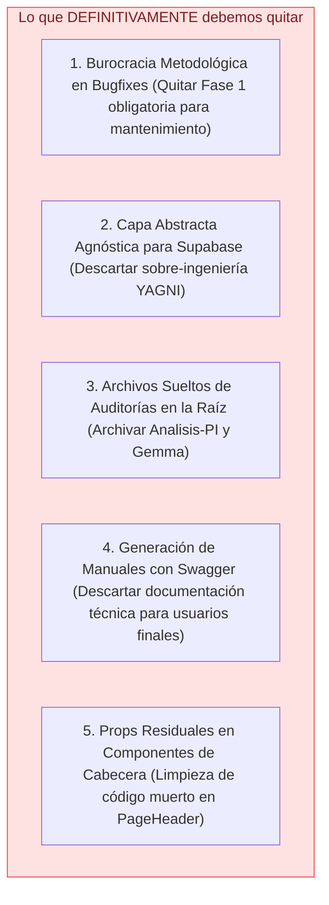
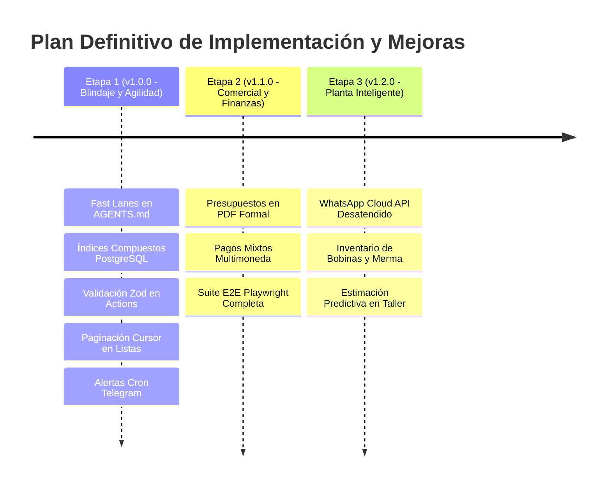

# Documento Consolidado de Decisiones Estratégicas: Comparativa Cruzada (PI vs. Gemma vs. Realidad APSys)

- **Fecha:** 16 de Octubre de 2026
- **Autor:** Antigravity Engineering Team / Principal Systems Architect
- **Versión de Base:** APSys `v0.9.2` (Producción en Vercel + Supabase)
- **Fuentes Auditadas:** `Analisis-PI.md` y `Analisis-Gemma.md`
- **Propósito:** Cruzar ambos análisis, eliminar el ruido y las alucinaciones, rescatar los aportes de alto valor y fijar el plan definitivo de lo que se **elimina**, lo que se **mejora** y lo que se **implementa**, alineado con el PRD, el plan de trabajo y la lista de tareas.

---

## 1. Comparativa Cruzada de Informes: Filtrando el Ruido

Ambos análisis fueron realizados desde ópticas completamente distintas:

- **`Analisis-PI.md`:** Micro-auditoría automatizada de bajo nivel. Aportó alertas útiles sobre la base de datos (índices, paginación, coherencia de columnas), pero sufrió de alucinaciones masivas en testing (afirmó falsamente que no había tests en 25 módulos e inventó código de pruebas sintético con errores graves de sintaxis y tipado).
- **`Analisis-Gemma.md`:** Macro-análisis arquitectónico y metodológico (SWOT). Acertó de lleno al diagnosticar la inmutabilidad de datos como el mayor valor del negocio y alertar sobre la **fricción por sobrediseño (overhead metodológico)**, sugiriendo "Fast Lanes" para bugfixes. Sin embargo, propuso un desacoplamiento teórico innecesario de Supabase y asumió erróneamente que el catálogo de servicios estaba hardcodeado.

### Matriz Comparativa y Juicio de Valor Técnico

| Dimensión Analizada          | Diagnóstico `Analisis-PI.md`                                                 | Diagnóstico `Analisis-Gemma.md`                                          | Realidad del Sistema APSys                                                | Decisión Estratégica Definitiva                                              |
| :--------------------------- | :--------------------------------------------------------------------------- | :----------------------------------------------------------------------- | :------------------------------------------------------------------------ | :--------------------------------------------------------------------------- |
| **Gobernanza y Procesos**    | No evaluado.                                                                 | Alerta de sobre-ingeniería metodológica en cambios menores.              | El ciclo de 5 fases de `AGENTS.md` ralentiza parches triviales de UI.     | **ADOPTAR Fast Lanes:** Vía rápida de TDD directo para bugfixes menores.     |
| **Pruebas Automatizadas**    | ❌ Alucinación: Afirmó que faltaban tests en 25 áreas y propuso código roto. | ✅ Certero: Reconoció la robustez y cobertura de Vitest y Playwright.    | 40 suites con 216 tests unitarios e integrales ejecutándose 100% verde.   | **DESCARTAR código de PI;** mantener y ampliar la suite real existente.      |
| **Base de Datos e Índices**  | ✅ Certero: Faltan índices explícitos en `pedidos` y `clientes`.             | Señala la inmutabilidad (`tasa_id`, `auditoria`) como fortaleza élite.   | `pedidos.numero_orden` tiene B-Tree, pero faltan índices en FKs y fechas. | **IMPLEMENTAR índices relacionales** en PostgreSQL (`0006_indices.sql`).     |
| **Paginación en Servidor**   | ✅ Certero: Listas planas de hasta 100 elementos sin paginación.             | No evaluado a bajo nivel.                                                | `/clientes` y `/pedidos` cargan bloques fijos en memoria.                 | **IMPLEMENTAR paginación por cursor** (`limit` + `created_at < cursor`).     |
| **Arquitectura de Backend**  | No evaluado.                                                                 | ⚠️ Teórico: Sugiere crear capas abstractas para desacoplar Supabase.     | Supabase provee RLS, WebSockets Realtime y Auth con JWT Edge (< 1ms).     | **DESCARTAR desacoplamiento artificial (YAGNI);** conservar Supabase nativo. |
| **Catálogo de Servicios**    | Señaló inconsistencia en columnas de ítems.                                  | ⚠️ Impreciso: Creyó que el catálogo estaba fijo en `seed-servicios.mjs`. | El catálogo ya es 100% dinámico con CRUD en `/servicios`.                 | **PRESERVAR módulo dinámico existente** en `/servicios`.                     |
| **Documentación de Usuario** | Propone tests para la comanda y ayuda.                                       | ⚠️ Impreciso: Propone generar manuales con Swagger/Storybook.            | El manual es una guía en español de negocio para operarios y vendedoras.  | **MANTENER Guía de Usuario en lenguaje humano** en `docs/capacitacion/`.     |

---

## 2. Lo que DEFINITIVAMENTE DEBEMOS QUITAR (Eliminaciones y Descartes)

Con el fin de reducir la deuda técnica, eliminar burocracia innecesaria y proteger la simplicidad operativa, se toma la decisión formal de retirar y descartar lo siguiente:

1. **QUITAR la rigidez del ciclo de 5 fases para mantenimiento menor:**
   - _Decisión:_ Modificar [AGENTS.md](file:///c:/Users/medin/Documents/Proyectos/APSys-Gemini/AGENTS.md) para eximir a las correcciones de bugs cosméticos, ajustes de CSS, tipografías y parches menores de requerir una especificación formal con `@system-architect` y auditoría `/ship`.
   - _Justificación:_ Evita que un cambio de 5 minutos tome 1 hora de overhead documental.

2. **DESCARTAR la capa abstracta intermedia para Supabase:**
   - _Decisión:_ No construir interfaces abstractas agnósticas (`services/order-service.ts`) para esconder Supabase.
   - _Justificación:_ Supabase es el pilar de RLS, autenticación y tiempo real. Abstraerlo agrega complejidad accidental sin ningún beneficio tangible para una PYME.

3. **QUITAR archivos de auditorías y pruebas sueltos de la raíz del proyecto:**
   - _Decisión:_ Archivar definitivamente [Analisis-PI.md](file:///c:/Users/medin/Documents/Proyectos/APSys-Gemini/Analisis-PI.md), [Analisis-Gemma.md](file:///c:/Users/medin/Documents/Proyectos/APSys-Gemini/Analisis-Gemma.md) y `pruebna.md` en [docs/analisis/2026-10-16/](file:///c:/Users/medin/Documents/Proyectos/APSys-Gemini/docs/analisis/2026-10-16/).
   - _Justificación:_ Despeja la raíz y evita que agentes de IA o nuevos desarrolladores analicen reportes con datos superados o alucinados.

4. **DESCARTAR la automatización de manuales de usuario con Swagger/Storybook:**
   - _Decisión:_ Mantener la redacción pedagógica en lenguaje natural de la [Guía Rápida de Usuarios](file:///c:/Users/medin/Documents/Proyectos/APSys-Gemini/docs/capacitacion/guia-rapida-usuarios.md).
   - _Justificación:_ Las vendedoras y operarios requieren orientación de negocio ("cómo cotizar con la tasa de mañana"), no contratos JSON de APIs.

5. **QUITAR props y estados residuales en componentes de UI:**
   - _Decisión:_ Limpiar props en desuso en componentes de cabecera (`PageHeader`) que quedaron huérfanos tras centralizar toda la navegación en el Sidebar.
   - _Justificación:_ Cero código muerto, interfaces TypeScript limpias.

---

## 3. Lo que DEFINITIVAMENTE DEBEMOS MEJORAR / IMPLEMENTAR (Plan Priorizado)

Las iniciativas se organizan en tres etapas de ejecución estricta, balanceando impacto en el negocio contra esfuerzo técnico:

### 🟢 Etapa 1: Blindaje Inmediato y Agilidad (Versión 1.0.0)

_Enfocada en rendimiento de base de datos, seguridad de datos y aceleración del equipo de desarrollo._

1. **Fast Lanes en `AGENTS.md`:** Regla formal que permite resolver hotfixes menores con TDD directo (Rojo-Verde-Refactor) sin burocracia de especificación.
2. **Índices Estratégicos en PostgreSQL:**
   - `idx_pedidos_cliente_id` (acelera el historial por cliente).
   - `idx_pedidos_estado` (acelera el tablero Kanban y filtros de órdenes activas).
   - `idx_pedidos_fecha_registro` (acelera dashboards y reportes por fecha).
   - `idx_clientes_telefono` (acelera la búsqueda reactiva en la creación de órdenes).
3. **Validación en Runtime con Zod:** Esquemas tipados en Server Actions para validar montos numéricos positivos, dimensiones y formatos telefónicos.
4. **Paginación por Cursor en `/clientes` y `/pedidos`:** Evitar la carga plana de memoria implementando consultas paginadas (`limit 25` + `created_at < cursor`).
5. **Alertas de Cron por Telegram/Email:** Micro-webhook que alerte a la gerencia si la sincronización automática de tasas del BCV falla durante más de 24 horas continuas.

---

### 🟡 Etapa 2: Potencia Comercial y Finanzas (Versión 1.1.0)

_Enfocada en elevar la imagen corporativa ante clientes y garantizar una conciliación de caja perfecta._

1. **Generador de Presupuestos y Comprobantes en PDF Vectorial:**
   - Creación de PDFs con membrete corporativo, datos del cliente, desglose de medidas, m², acabados y montos en USD y Bolívares oficiales.
   - Descarga en 1 clic para compartir directamente por WhatsApp o correo.
2. **Desglose de Pagos Mixtos y Multimoneda (`pedido_pagos`):**
   - Soporte para fraccionar el pago de una orden en múltiples vías (ejemplo: $40 Efectivo USD + $30 Zelle + saldo en Bolívares por Pago Móvil con referencia bancaria).
   - Eliminación de descuadres de caja al cierre de jornada.
3. **Ampliación de Pruebas E2E en Playwright:** Suite automatizada que valide el recorrido integral del usuario: inicio de sesión, cotización con tasa de mañana, visualización en taller y emisión de comanda.

---

### 🔵 Etapa 3: Planta Inteligente y Manufactura (Versión 1.2.0)

_Enfocada en eliminar tiempos muertos de producción y controlar el inventario de materiales._

1. **WhatsApp Cloud API Desatendido:** Disparo automático de mensaje al cliente cuando la orden se marca como "Listo para Retiro", sin requerir clics del operario ni abrir `wa.me` en el navegador.
2. **Módulo de Inventario de Bobinas y Merma:** Control de stock de metros lineales (lona banner, vinil) con descuento automático por orden y cálculo de porcentaje de desperdicio por corte.
3. **Estimación Predictiva de Tiempos de Entrega:** Cálculo automatizado de la fecha estimada de retiro basado en la carga actual de metros cuadrados del taller.

---

## 4. Matriz de Trazabilidad hacia Documentos del Repositorio

| Iniciativa Consolidada           | Documento PRD / MVP (`docs/specs/`)         | Archivo de Planificación (`tasks/plan.md`) | Lista de Tareas (`tasks/todo.md`) |
| :------------------------------- | :------------------------------------------ | :----------------------------------------- | :-------------------------------- |
| **Fast Lanes (Gobernanza Ágil)** | Sección 4 (Stack y Metodología)             | Sección 1 (Gobernanza)                     | Backlog Inmediato (v1.0.0)        |
| **Índices PostgreSQL**           | Requisitos No Funcionales (RNF Rendimiento) | Fase 28: Blindaje Técnico                  | Backlog Inmediato (v1.0.0)        |
| **Validación Zod en Actions**    | Sección 5 (Módulo A: Recepción y Registro)  | Fase 28: Blindaje Técnico                  | Backlog Inmediato (v1.0.0)        |
| **Paginación por Cursor**        | Requisitos No Funcionales (Escalabilidad)   | Fase 28: Blindaje Técnico                  | Backlog Inmediato (v1.0.0)        |
| **Alertas Cron Telegram**        | Sección 2 (Infraestructura y Monitoreo)     | Fase 28: Blindaje Técnico                  | Backlog Inmediato (v1.0.0)        |
| **Presupuestos en PDF Formal**   | RF-14 / Módulo Comercial                    | Fase 29: Comercial y Pagos                 | Backlog Sprint 1 (v1.1.0)         |
| **Pagos Mixtos Multimoneda**     | RF-05 / Módulo Cobranzas                    | Fase 29: Comercial y Pagos                 | Backlog Sprint 1 (v1.1.0)         |
| **WhatsApp Cloud API**           | Alcance Posterior (Fase 2)                  | Fase 30: Automatización Planta             | Backlog Sprint 2 (v1.2.0)         |
| **Inventario de Bobinas**        | Alcance Posterior (Fase 2)                  | Fase 30: Automatización Planta             | Backlog Sprint 2 (v1.2.0)         |
