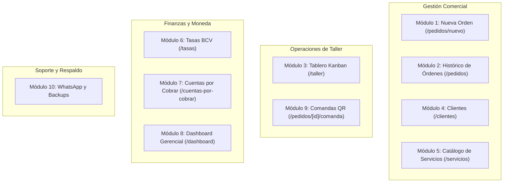
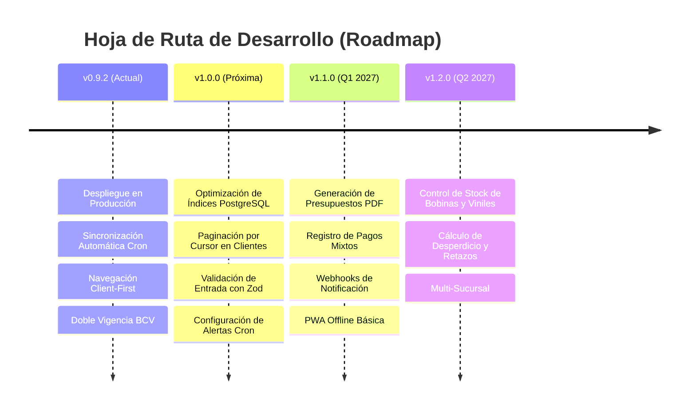

# Resumen Ejecutivo Integral: Sistema APSys

- **Fecha:** 16 de Octubre de 2026
- **Versión de Referencia:** APSys `v0.9.2` (Producción en Vercel + Supabase)
- **Sector de Aplicación:** Industria de Publicidad Exterior, Gigantografía, Impresión Digital y Rotulación Comercial.
- **Mercado Objetivo:** Empresas de artes gráficas y talleres de producción en Venezuela con operaciones en economía bimonetaria (USD / Bolívares BCV).

---

## 1. Identidad, Misión y Propósito del Sistema

**APSys** (Advanced Production System) es una plataforma web de alto rendimiento diseñada específicamente para centralizar, controlar y acelerar el ciclo de vida operativo y comercial de empresas de gigantografía e impresión en gran formato.

El sistema resuelve la desconexión típica entre el área comercial (ventas, cotización de metros cuadrados, cobranza) y el piso de planta o taller (diseño, preparación de archivos, impresión en plotters, acabados y despacho), incorporando una solución nativa a la volatilidad cambiaria venezolana mediante un motor de doble vigencia de tasas oficiales del Banco Central de Venezuela (BCV).

---

## 2. Arquitectura de Software y Stack Tecnológico

APSys fue concebido bajo estándares de ingeniería modernos, priorizando la velocidad de respuesta en planta y la integridad de los datos financieros:

1. **Frontend & Framework:** **Next.js 16 (App Router)** sobre **React 19**, compilado con **Turbopack**.
2. **Estilo y Diseño UI:** **Tailwind CSS v4** utilizando la paleta Zinc/Slate con soporte completo para modo oscuro y componentes ergonómicos universales (`CustomSelect`).
3. **Estrategia de Navegación Client-First:** Implementación de navegación instantánea (< 50ms) con hidratación reactiva vía React Context (`AuthContext`, `TasasContext`), eliminando bloqueos de servidor en el cambio de rutas y suprimiendo parpadeos de interfaz.
4. **Base de Datos y Seguridad:** **Supabase PostgreSQL** con **Row Level Security (RLS)** estricto por roles (`operativo` y `gerencial`). Todas las modificaciones y anulaciones quedan registradas en una tabla inmutable de `auditoria` con justificación obligatoria.
5. **Motor de Tasas Cambiarias y Sincronización:**
   - Consumo primario de **DolarVZLA API** (USD y EUR oficiales en una sola petición HTTP).
   - Resiliencia mediante fallback automático a **DolarApi**.
   - Caché en memoria con TTL de 5 minutos y bypass forzado.
   - Sincronización autónoma mediante **Cron Jobs de Vercel** autenticados con `CRON_SECRET` y cliente administrativo `SUPABASE_SERVICE_ROLE_KEY`.
6. **Calidad y Testing:** Suite de **Vitest** con 40 archivos de prueba y 216 tests automatizados al 100% en verde, complementado con pruebas de navegación E2E con **Playwright**.

---

## 3. Ventajas Competitivas y Fortalezas Técnicas

| Fortaleza                                      | Impacto Técnico y Operativo                                                                                                                                                                                                         |
| :--------------------------------------------- | :---------------------------------------------------------------------------------------------------------------------------------------------------------------------------------------------------------------------------------- |
| **Protección Cambiaria Dual (Hoy vs. Mañana)** | Detecta automáticamente si el BCV publicó la tasa del siguiente día hábil a las 5:00 p. m. Permite cotizar pedidos con la "Tasa de Mañana" protegiendo el margen comercial sin alterar las órdenes facturadas con la tasa de hoy.   |
| **Taller Kanban Reactivo en Tiempo Real**      | Los operarios en planta ven aparecer nuevas órdenes y cambios de estado instantáneamente vía Supabase Realtime (con polling continuo de 5s como respaldo). Cero necesidad de recargar la página manualmente en pantallas de taller. |
| **Navegación Fluida Instantánea (< 50ms)**     | La eliminación de Server Components bloqueantes en el layout permite alternar entre Taller, Pedidos y Clientes con la inmediatez de una Single Page Application (SPA).                                                              |
| **Seguridad y Control de Roles Estricto**      | Los operadores de taller y ventas no tienen acceso a métricas globales de facturación ni márgenes financieros (RF-19). La base de datos deniega el acceso a nivel de fila (RLS).                                                    |
| **Auditoría Inmutable**                        | Ninguna orden puede anularse o modificarse sustancialmente sin que el sistema exija un motivo explícito, registrando usuario, timestamp y valores anteriores.                                                                       |
| **Consistencia Ergonómica y Accesibilidad**    | Selector `CustomSelect` adaptado para entornos táctiles de taller, con filtrado en tiempo real, navegación por teclado WAI-ARIA y soporte de scrollbar estilizado.                                                                  |

---

## 4. Desventajas y Riesgos del Sistema

1. **Dependencia de Proveedores Cambiarios Externos:** Si la API del BCV sufre bloqueos o tanto DolarVZLA como DolarApi experimentan caídas prolongadas de red, el sistema depende del respaldo de la última tasa registrada en base de datos o de la sincronización manual del operador.
2. **Limitaciones del Plan de Infraestructura Gratuito (Vercel Hobby):** Vercel limita las cuentas gratuitas a 1 ejecución de cron por día. Aunque el sistema está diseñado para ejecución dual (tarde y medianoche), en el plan Hobby solo se activará una ejecución diaria si no se migra a Vercel Pro.
3. **Escalabilidad de Listados sin Paginación por Cursor:** Las pantallas de `/clientes` y `/pedidos` cargan bloques fijos en memoria. Cuando el taller supere los 2.000 clientes o 10.000 pedidos, será mandatorio incorporar paginación por cursor en base de datos para no degradar el consumo de memoria móvil.
4. **Dependencia de Conectividad a Internet:** Al estar alojado en la nube (Vercel + Supabase), cortes eléctricos o fallas del servicio de internet en el taller detienen la recepción de órdenes si no se cuenta con enlace de respaldo o soporte offline PWA.

---

## 5. Oportunidades Estratégicas de Negocio

1. **Integración con WhatsApp Cloud API (Webhooks Oficiales):** Actualmente el sistema genera enlaces `wa.me` con plantillas formateadas que el usuario envía con un clic. La integración con la API oficial de Meta permitirá envíos 100% desatendidos cuando una orden pase al estado "Listo para Retiro".
2. **Módulo de Inventario de Materia Prima y Bobinas:** Calcular el consumo de metros lineales de viniles y lonas por cada orden, alertando sobre niveles críticos de stock y m² restantes por rollo.
3. **Cálculo de Anidado y Aprovechamiento de Material (_Nesting_):** Algoritmo que asista al operario en agrupar pedidos sobre el ancho de bobina (1.60m, 2.20m, 3.20m) para minimizar el desperdicio de material.
4. **Multi-Sucursal / Multi-Taller:** Habilitar un modelo multitenant para empresas que tienen mostradores de venta en varias ciudades y un solo taller centralizado de impresión.

---

## 6. Alcance del Sistema (In-Scope vs. Out-of-Scope)

### ✅ Dentro del Alcance (In-Scope)

- **Recepción y Cotización de Órdenes:** Formulario de pedidos con cálculo por dimensiones (alto x ancho x cantidad), área en m², acabados (ojales, bolsillos, laminado, corte) y precio total en USD y Bs.
- **Selección de Vigencia Cambiaria:** Capacidad de cotizar con Tasa Vigente (hoy) o Tasa Programada (mañana).
- **Flujo Operativo de Taller (Kanban):** Gestión visual de 4 estados: _Pendiente_, _En Producción_, _Listo para Retiro_, _Entregado_ y _Anulado_.
- **Directorio de Clientes:** Ficha técnica, historial de compras, teléfono con formato directo para WhatsApp y saldos adeudados.
- **Catálogo de Servicios:** Precios base por m² o unidad para Pendones, Viniles, Backing, Microperforado, Etiquetas y más.
- **Módulo de Cuentas por Cobrar (CxC):** Registro de pagos y abonos parciales, seguimiento de morosidad y alertas de cobro.
- **Dashboard Gerencial:** Gráficas de ingresos por período, ticket promedio, distribución por servicios y rotación de productos.
- **Comandas Físicas de Taller:** Vista de impresión optimizada para tickets de taller con código QR para seguimiento rápido.
- **Motor de Mensajería WhatsApp:** Plantillas dinámicas de cobro, inicio de producción y retiro de mercancía.
- **Gobernanza de Datos:** Script de respaldo criptográfico JSON con SHA-256 y script de restauración relacional con orden de dependencias.

### ❌ Fuera del Alcance (Out-of-Scope)

- **Nómina y Recursos Humanos:** No incluye control de horas trabajadas, cálculo de sueldos ni liquidación de personal.
- **Contabilidad Fiscal Formal:** No genera declaraciones de IVA, libros de compra/venta tributarios ni conexión directa con máquinas fiscales SENIAT.
- **Telemetría IoT de Máquinas:** No se conecta por hardware a los plotters de impresión para leer niveles físicos de tinta o cabezales.
- **Portal de Auto-Servicio / E-commerce B2C:** El sistema está diseñado exclusivamente para uso interno de operadores y gerentes de la empresa, no para que clientes externos carguen sus propios archivos en línea.

---

## 7. Catálogo Detallado de Funcionalidades por Módulo

### Módulo 1: Cotizador y Nueva Orden (`/pedidos/nuevo`)

- Búsqueda reactiva de cliente con `CustomSelect` o registro rápido en modal sin abandonar la pantalla.
- Selector de fecha de cotización (Tasa de Hoy vs. Tasa de Mañana cuando existe tasa futura programada).
- Renglones dinámicos de ítems: selección de servicio, especificación de ancho, alto, cantidad, cálculo automático de m² y selector de acabados.
- Desglose instantáneo en USD y Bolívares a la tasa correspondiente.

### Módulo 2: Maestro y Búsqueda de Pedidos (`/pedidos`)

- Tabla centralizada de todas las órdenes emitidas con buscador predictivo por número de orden (`ORD-XXXX`), nombre de cliente o teléfono.
- Filtros por estado (_Pendiente_, _En Producción_, _Listo_, _Entregado_, _Anulado_).
- Acciones rápidas: ver comanda, cambiar estado, registrar abono o anular con justificación de auditoría.

### Módulo 3: Tablero Kanban de Taller en Tiempo Real (`/taller`)

- Visualización en columnas optimizada para monitores de planta.
- Tarjetas con información clave: número de orden, cliente, medidas en metros, acabados y notas de taller.
- Movimiento de estados en 1 clic con confirmación visual.
- Actualización automática desatendida mediante Supabase Realtime y sincronización reactiva de props.

### Módulo 4: Directorio y Gestión de Clientes (`/clientes`)

- Registro de clientes con identificación (C.I. / RIF), correo, teléfono celular con validación internacional y dirección física.
- Historial histórico de órdenes acumuladas por cliente y saldo deudor consolidado.

### Módulo 5: Catálogo de Servicios (`/servicios`)

- Mantenimiento del catálogo de productos gráficos (lona banner, vinil mate/brillante, microperforado, pendones con soporte, adhesivos laminados).
- Fijación de precio unitario base en USD por m² o unidad.
- Parámetros de cobro mínimo por diseño o corte.

### Módulo 6: Motor Cambiario Oficial BCV (`/tasas`)

- Monitor visual de la tasa oficial del Dólar y Euro BCV.
- Panel de sincronización inmediata a 1 toque con las APIs de DolarVZLA y DolarApi.
- Programación de vigencia inteligente: si el BCV emite tasa con fecha de mañana, el sistema la almacena con vigencia a partir de las `00:00:00-04:00` del día siguiente sin alterar las órdenes del día de hoy.
- Tabla histórica de vigencias con badges de estado: _Vigente_ (verde), _Programada_ (ámbar) e _Histórica_ (gris).

### Módulo 7: Cuentas por Cobrar y Cobranzas (`/cuentas-por-cobrar`)

- Listado de órdenes entregadas o en producción con saldo deudor pendiente.
- Cálculo de antigüedad de saldo y morosidad.
- Modal de abonos parciales: registro de pago con fecha, monto en USD/Bs y referencia bancaria.

### Módulo 8: Dashboard Gerencial de Ingresos y Rotación (`/dashboard`)

- Indicadores Clave de Desempeño (KPIs): Total facturado, cuentas por cobrar totales, pedidos completados y ticket promedio.
- Gráficas de evolución mensual de ingresos.
- Sub-módulo `/dashboard/rotacion`: Reporte de servicios más vendidos por volumen de pedidos, total en USD generados y m² impresos.
- Exportación de datos analíticos a formato CSV.

### Módulo 9: Comandas Operativas para Taller (`/pedidos/[id]/comanda`)

- Formato imprimible blanco y negro optimizado para impresoras térmicas de 80mm o papel carta.
- Código QR integrado que contiene el link directo de la orden para escaneo rápido con la cámara de un smartphone o tablet en taller.
- Especificaciones milimétricas de corte, ojales y acabados para el operario de máquina.

### Módulo 10: Mensajería de Notificación y Respaldos del Sistema

- `/recordatorios` y `/plantillas`: Generador de mensajes con variables dinámicas (`{nombre_cliente}`, `{numero_orden}`, `{saldo_pendiente}`) para WhatsApp.
- Scripts de infraestructura:
  - `scripts/backup-supabase.mjs`: Extracción cifrada de datos en JSON con hash criptográfico SHA-256.
  - `scripts/restore-supabase.mjs`: Script de restauración relacional con validación de dependencias para planes de contingencia ante desastres.

---

## 8. Roadmap de Evolución Técnica y Negocio

### Versión 0.9.2 (Estado Actual - Completada)

- ✅ Estabilización de Next.js 16 y React 19.
- ✅ Arquitectura Client-First con tiempos de transición < 50ms.
- ✅ Motor de doble vigencia BCV con DolarVZLA y fallback.
- ✅ Cron de sincronización serverless con Vercel.
- ✅ Manuales de usuario y runbooks operativos sincronizados.

### Versión 1.0.0 (Lanzamiento Oficial de Estabilidad)

- Creación de índices compuestos en PostgreSQL (`pedidos_cliente_id_idx`, `pedidos_estado_idx`).
- Implementación de paginación por cursor en `/clientes` y `/pedidos`.
- Validación tipada en tiempo de ejecución con esquemas Zod en todas las Server Actions.
- Ajuste final de la periodicidad del cron job según el plan contratado en Vercel.

### Versión 1.1.0 (Automatización y Experiencia Comercial)

- Descarga de presupuestos y comandas en PDF vectorial con diseño corporativo formal.
- Desglose de pagos mixtos (ej. 30% efectivo USD + 70% Pago Móvil Bs BCV).
- Canal de alertas vía Telegram/Discord para monitorear ejecuciones del cron job y fallos de API.
- Modo PWA básico con caché de catálogo para consulta de precios sin conexión a internet.

### Versión 1.2.0 (Gestión de Sustratos y Materiales)

- Módulo de control de inventario de bobinas (lona banner, vinil, microperforado).
- Alertas de reposición de tinta y metros lineales disponibles.
- Reporte de m² aprovechados vs. m² de merma por orden de producción.
