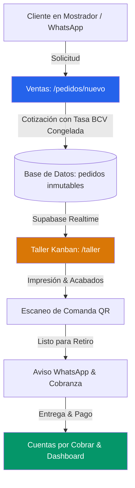
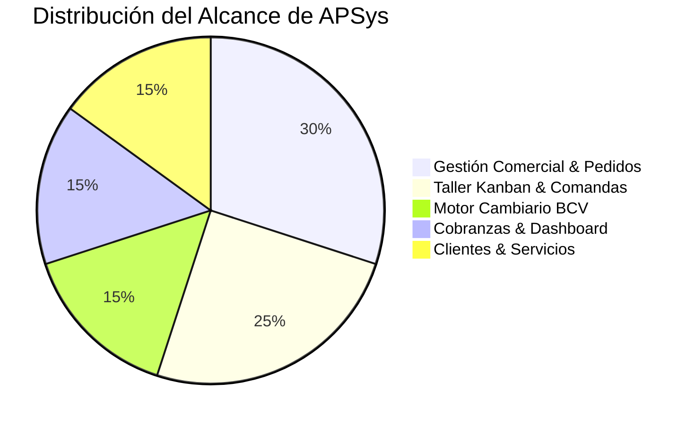
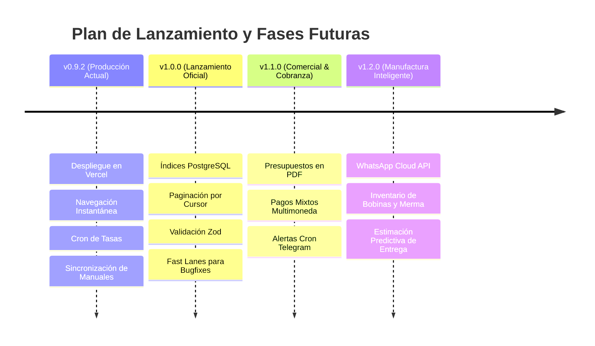

# Resumen Ejecutivo Integral: Arquitectura, Operación y Futuro de APSys

- **Fecha:** 16 de Octubre de 2026
- **Versión:** APSys `v0.9.2` (Producción en Vercel + Supabase)
- **Perspectiva:** Análisis Ejecutivo de Negocio, Tecnología y Gobernanza Operativa

---

## 1. Misión y Propuesta de Valor

**APSys** (Advanced Production System) es el sistema operativo digital concebido para resolver la fricción comercial, operativa y cambiaria en talleres de gigantografía, rotulación y producción publicitaria en Venezuela.

La plataforma conecta el mostrador comercial con las mesas de corte e impresoras de gran formato, garantizando:

1. **Precisión Milimétrica en Costos:** Cotización automatizada de metros cuadrados (`ancho x alto x cantidad`), cálculo de mermas y adición de acabados (ojales reforzados, bolsillos para tubos, laminado mate/brillante).
2. **Blindaje Financiero Bimonetario:** Conversión instantánea entre Dólares estadounidenses (moneda base de cálculo) y Bolívares oficiales del BCV, con congelamiento de tasa por pedido y soporte de **doble vigencia temporal** (tasa de hoy vs. tasa programada del día siguiente).
3. **Flujo de Producción Reactivo:** Taller sin papeles ni gritos; monitores de planta actualizados al segundo mediante Supabase Realtime para que los impresores y rotuladores conozcan sus prioridades de trabajo al instante.

---

## 2. Arquitectura Tecnológica y Patrones de Diseño

El sistema está construido sobre un stack de última generación, optimizado para latencias mínimas y alta disponibilidad:

- **Frontend y SSR:** **Next.js 16 (App Router)** con **React 19** y compilación turbo con **Turbopack**.
- **Arquitectura de Interfaz:** Modelo **Client-First / Instant Navigation**. Los layouts principales (`AuthenticatedShell`) están desacoplados de llamadas bloqueantes de servidor, apoyándose en **React Context** (`AuthContext`, `TasasContext`) para alternar entre rutas en menos de **50 milisegundos**.
- **Capa de Estilos y Ergonomía:** **Tailwind CSS v4** (paleta Zinc), tipografía moderna optimizada, soporte completo para modo oscuro y el componente universal `CustomSelect` adaptado para interacción táctil en pantallas de taller.
- **Persistencia y Seguridad:** **Supabase PostgreSQL** gobernado por **Row Level Security (RLS)**. Se diferencian los roles `operativo` (taller, cotizaciones, órdenes) y `gerencial` (métricas de facturación, márgenes y administración global).
- **Motor Cambiario:** Integración primaria con **DolarVZLA API** (USD y EUR en 1 sola llamada) con fallback automático a **DolarApi**, caché en memoria con TTL de 5 minutos y sincronización desatendida mediante **Vercel Crons** con `CRON_SECRET` y Service Role Key.
- **Auditoría e Inmutabilidad:** Tabla append-only `auditoria`. Queda prohibido el borrado destructivo de pedidos; cualquier anulación exige justificación obligatoria y preserva el historial.

---

## 3. Matriz Estratégica: Ventajas, Desventajas y Oportunidades

### 3.1 Ventajas Competitivas (Fortalezas Principales)

1. **Inmutabilidad y Coherencia Financiera:** Cada pedido almacena una clave foránea `tasa_id` congelada al momento de su creación. Si el dólar sube al día siguiente, los pedidos históricos mantienen su valor original en bolívares pactado con el cliente.
2. **Doble Vigencia de Tasas (Hoy vs. Mañana):** Cuando el Banco Central de Venezuela publica la tasa del día siguiente a las 5:00 p. m., el sistema permite a los vendedores cotizar trabajos para mañana con el precio nuevo, sin desfasar las órdenes emitidas en el día en curso.
3. **Planta en Tiempo Real (Cero Refrescos):** El tablero Kanban en `/taller` se sincroniza automáticamente mediante WebSockets de Supabase, incorporando sondeo secundario de respaldo de 5 segundos.
4. **Calidad de Código Probada:** 40 suites de prueba con 216 tests unitarios e integrales en Vitest ejecutándose en verde en CI, con TypeScript en modo estricto.

### 3.2 Desventajas y Puntos de Fricción

1. **Fricción Metodológica en Tareas Menores (Overhead):** Como bien identificó el análisis de arquitectura, aplicar un protocolo formal de 5 fases (especificación previa con arquitecto, desglose atómico, TDD, auditoría y compuerta) ralentiza correcciones cosméticas o ajustes de estilos mínimos.
2. **Dependencia de Red y APIs Externas:** Al estar en la nube, la sincronización automática depende de la disponibilidad de los proveedores de scraping del BCV y de la estabilidad del internet en el taller.
3. **Límite de Ejecuciones de Cron en Vercel Hobby:** El plan gratuito de Vercel solo permite 1 ejecución de cron job por día, lo que exige evaluar un webhook externo o migración a Vercel Pro para la sincronización dual (tarde y medianoche).
4. **Escalabilidad de Listas Extensas:** Las pantallas de `/clientes` y `/pedidos` requieren migrar a paginación por cursor en servidor cuando el volumen de clientes supere los miles de registros.

### 3.3 Oportunidades de Alto Impacto

1. **Implementación de "Fast Lanes":** Habilitar una vía rápida para correcciones de bugs menores y tareas de mantenimiento que no alteren la lógica de negocio, reduciendo el tiempo de entrega de minutos a segundos.
2. **WhatsApp Cloud API Desatendido:** Conectar webhooks directos con la API oficial de Meta para que, en el instante en que el taller mueva una orden a "Listo para Retiro", el cliente reciba un mensaje automatizado con el saldo pendiente y la dirección del taller.
3. **Dashboard Predictivo de Producción:** Algoritmo de estimación de tiempos de entrega basado en el histórico de m² y acabados de pedidos anteriores.
4. **Inventario de Sustratos (Bobinas y Viniles):** Módulo de control de metros lineales disponibles y cálculo de merma por orden producida.

---

## 4. Delimitación del Alcance del Sistema

### ✅ Dentro del Alcance (In-Scope)

- Cotización paramétrica de servicios gráficos por dimensiones, metros cuadrados y acabados.
- Soporte para cotizar con Tasa Vigente (hoy) o Tasa Programada (mañana).
- Maestro de órdenes con buscador predictivo y filtros por estado.
- Tablero Kanban operativo para seguimiento de estados en planta (_Pendiente_, _En Producción_, _Listo_, _Entregado_, _Anulado_).
- Directorio de clientes con validación telefónica y consolidación de saldos deudores.
- Catálogo dinámico de servicios gráficos con precios base configurables en USD.
- Motor de tasas oficiales BCV (USD y EUR) con sincronización manual a 1 toque y automática por cron.
- Módulo de Cuentas por Cobrar con registro de abonos y antigüedad de deuda.
- Dashboard de métricas gerenciales y reporte analítico de rotación de servicios.
- Comandas de taller imprimibles en formato ticket con código QR.
- Generador de mensajes formateados para WhatsApp.
- Respaldos criptográficos de datos con verificación SHA-256 y script de restauración relacional.

### ❌ Fuera del Alcance (Out-of-Scope)

- **Nómina y Gestión de Recursos Humanos:** El sistema no calcula salarios, asistencias ni beneficios de ley de los empleados.
- **Facturación Fiscal SENIAT:** No reemplaza la máquina fiscal ni emite libros contables formales de compra y venta.
- **Conexión IoT con Maquinaria:** No monitorea sensores de cabezales, niveles de tinta física ni temperaturas de secado de los plotters.
- **Tienda Pública de Auto-Servicio:** APSys es una herramienta interna de gestión privada; no permite a compradores finales subir archivos sin intermediación del personal de ventas.

---

## 5. Catálogo Funcional de los 10 Módulos de APSys

|   #    | Módulo                  | Ruta                    | Funcionalidad Principal                                                                                    |
| :----: | :---------------------- | :---------------------- | :--------------------------------------------------------------------------------------------------------- |
| **1**  | **Nueva Orden**         | `/pedidos/nuevo`        | Cotizador instantáneo con selector de clientes, cálculo de m², acabados y selector de tasa hoy vs. mañana. |
| **2**  | **Maestro de Pedidos**  | `/pedidos`              | Búsqueda predictiva de órdenes (`ORD-XXXX`), filtrado por estado y acceso a comandas y abonos.             |
| **3**  | **Taller Kanban**       | `/taller`               | Tablero reactivo en tiempo real para operarios en planta con actualización desatendida.                    |
| **4**  | **Clientes**            | `/clientes`             | Ficha técnica, historial de compras, contacto directo por WhatsApp y saldos pendientes.                    |
| **5**  | **Servicios**           | `/servicios`            | Administración de precios por m², cobros mínimos y activación/desactivación de productos gráficos.         |
| **6**  | **Tasas de Cambio**     | `/tasas`                | Monitor Dólar/Euro BCV, sincronización a 1 clic, histórico con badges de vigencia y cron automático.       |
| **7**  | **Cuentas por Cobrar**  | `/cuentas-por-cobrar`   | Control de saldos morosos, registro de abonos y cálculo de deudas en USD y Bolívares.                      |
| **8**  | **Dashboard Gerencial** | `/dashboard`            | KPIs de facturación, ticket promedio, gráficas mensuales y análisis de rotación de servicios.              |
| **9**  | **Comandas QR**         | `/pedidos/[id]/comanda` | Hoja de producción optimizada para imprimir con especificaciones técnicas y QR de seguimiento.             |
| **10** | **Soporte & Respaldos** | `/recordatorios` + CLI  | Plantillas dinámicas de WhatsApp y scripts de respaldo/restauración JSON con SHA-256.                      |

---

## 6. Roadmap Estratégico de Evolución

### Versión 0.9.2 (Estado Actual en Producción)

- Despliegue operativo en Vercel y Supabase.
- Suite de 216 pruebas automatizadas aprobadas.
- Motor de doble vigencia cambiaria y cron serverless.

### Versión 1.0.0 (Lanzamiento Oficial de Estabilidad)

- Creación de índices compuestos en PostgreSQL (`pedidos_cliente_id_idx`, `pedidos_estado_idx`).
- Implementación de paginación por cursor en `/clientes` y `/pedidos`.
- Validación tipada en tiempo de ejecución con esquemas Zod en todas las Server Actions.
- Adopción formal de **Fast Lanes** en `AGENTS.md` para agilizar parches menores.

### Versión 1.1.0 (Comercial y Cobranza Avanzada)

- Generador de Presupuestos descargables en PDF formal con diseño vectorial.
- Registro de pagos mixtos (combinación de efectivo, Zelle y transferencias en Bs).
- Canal de alertas por Telegram para fallas en la sincronización de tasas.

### Versión 1.2.0 (Automatización de Planta)

- WhatsApp Cloud API oficial para avisos desatendidos de retiro.
- Control de inventario de bobinas (lona banner, vinil) y mermas por corte.
- Estimación de tiempos de entrega en el tablero Kanban según la carga de trabajo.
