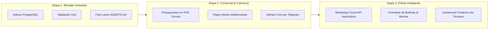

# Propuestas de Ingeniería y Gobernanza: Qué Mejorar, Qué Eliminar y Qué Implementar

- **Fecha:** 16 de Octubre de 2026
- **Autor:** Antigravity Engineering Team / Senior Software Architect
- **Contexto:** Evaluación de las recomendaciones de `Analisis-Gemma.md` aplicadas al sistema real APSys `v0.9.2`.
- **Objetivo:** Equilibrar la calidad de ingeniería de élite con la agilidad y velocidad de entrega comercial.

---

## 1. El Gran Dilema: Rigor Metodológico vs. Agilidad de Negocio

El principal aporte de `Analisis-Gemma.md` no es sobre una línea de código específica, sino sobre **la gobernanza del desarrollo**.

Gemma identificó con precisión una tensión latente:

- **El extremo del desorden:** Desarrollar sin especificación ni pruebas produce código frágil, bugs cambiarios y fallos de caja en el taller.
- **El extremo de la burocracia:** Exigir que cada cambio de texto o corrección de padding pase por `@system-architect`, cree un documento PRD, diseñe un plan atómico y ejecute una auditoría `/ship` completa con tres subagentes paraliza la evolución del producto.

Nuestra respuesta debe ser **disciplina inteligente**: mantener un rigor total para la lógica financiera y cambiaria, al tiempo que habilitamos vías rápidas para el mantenimiento diario.

---

## 2. Qué Mejorar (Refinamiento de Procesos y Código)

### 2.1 Institucionalizar "Fast Lanes" (Vías Rápidas) en `AGENTS.md`

- **Diagnóstico de Gemma:** El proceso de 5 fases es excesivo para correcciones de errores cosméticos o parches menores.
- **Mejora Propuesta:** Incorporar en [AGENTS.md](file:///c:/Users/medin/Documents/Proyectos/APSys-Gemini/AGENTS.md) una regla de bifurcación de flujo de trabajo:
  - **Ruta Estándar (Features Nuevos / Lógica Crítica):** Requiere Especificación con `@system-architect` → Plan en `tasks/todo.md` → TDD Incremental → Auditoría `/ship`.
  - **Ruta Fast Lane (Bugfixes Menores / Estilos / Ajustes de UI):** Se omite la fase de arquitectura. Solo requiere:
    1. Escribir o ajustar un test que demuestre el error (Rojo).
    2. Aplicar el cambio mínimo que haga pasar el test (Verde).
    3. Validar `npm test` y compilar antes de hacer commit.
- **Impacto:** Reduce el tiempo de resolución de bugs menores en más de un 60%, sin comprometer la suite de pruebas.

### 2.2 Índices Relacionales en PostgreSQL (Supabase)

- **Diagnóstico:** Las búsquedas de pedidos por cliente o estado y las consultas del dashboard por fechas realizan escaneos secuenciales innecesarios.
- **Mejora Propuesta:** Aplicar la migración de índices B-Tree en Supabase:
  ```sql
  CREATE INDEX IF NOT EXISTS idx_pedidos_cliente_id ON pedidos(cliente_id);
  CREATE INDEX IF NOT EXISTS idx_pedidos_estado ON pedidos(estado);
  CREATE INDEX IF NOT EXISTS idx_pedidos_fecha_registro ON pedidos(fecha_registro DESC);
  CREATE INDEX IF NOT EXISTS idx_clientes_telefono ON clientes(telefono);
  ```
- **Impacto:** Garantiza que las consultas de planta y ventas respondan en milisegundos cuando la base de datos alcance decenas de miles de pedidos.

### 2.3 Paginación por Cursor en `/clientes` y `/pedidos`

- **Diagnóstico:** Cargar listas de 50 o 100 elementos sin paginación degrada el rendimiento en dispositivos móviles con memoria limitada.
- **Mejora Propuesta:** Implementar paginación por cursor en servidor (`limit 25` + `created_at < cursor`) con carga continua o botones de avance.
- **Impacto:** Tiempos de carga planos e independientes del tamaño del histórico acumulado.

### 2.4 Validación Tipada en Runtime con Zod

- **Diagnóstico:** Las Server Actions confían en la tipificación de TypeScript y en restricciones de la base de datos, pero carecen de validación de esquemas en tiempo de ejecución.
- **Mejora Propuesta:** Crear esquemas de validación Zod en `lib/validaciones/` para rechazar payloads con montos negativos o campos corruptos antes de consultar Supabase.
- **Impacto:** Blindaje absoluto contra inyecciones de datos anómalos desde formularios cliente.

### 2.5 Resiliencia del Cron Job de Tasas con Alertas por Webhook

- **Diagnóstico:** El cron de Vercel registra sus ejecuciones en la base de datos, pero no alerta proactivamente si la API del BCV experimenta una caída prolongada.
- **Mejora Propuesta:** Agregar un micro-webhook (hacia un bot privado de Telegram o correo electrónico) que dispare un aviso si ocurren 3 fallas consecutivas de sincronización.
- **Impacto:** Alerta temprana para la gerencia antes de abrir el taller comercial en la mañana.

---

## 3. Qué Eliminar (Reducción de Deuda Técnica y Burocracia)

### 3.1 Eliminar la Rigidez de la Fase 1 para Tareas de Mantenimiento

- **Qué retirar:** La obligatoriedad de invocar a `@system-architect` para tareas de mantenimiento rutinario, refactorizaciones cosméticas o actualización de dependencias.
- **Justificación:** El arquitecto debe reservarse para diseñar contratos de datos, modelos de negocio o integraciones complejas.

### 3.2 Descartar la Capa de Abstracción Agnóstica para Supabase

- **Qué descartar:** La propuesta de Gemma de abstraer Supabase detrás de una capa de servicios genérica (`services/order-service.ts`) para un hipotético cambio de base de datos en el futuro.
- **Justificación:** **Anti-patrón YAGNI (You Aren't Gonna Need It).** Supabase provee autenticación, políticas RLS evaluadas en el motor PostgreSQL y WebSockets en tiempo real. Abstraer todo esto generaría cientos de líneas de código duplicado sin ningún beneficio real para una PYME gráfica.

### 3.3 Archivar Documentos de Auditoría Sueltos en la Raíz

- **Qué retirar:** Mover archivos temporales de auditorías como `Analisis-PI.md`, `Analisis-Gemma.md` y `pruebna.md` a la carpeta histórica organizada `docs/analisis/2026-10-16/`.
- **Justificación:** Mantener reportes con códigos sintéticos rotos o afirmaciones superadas en la raíz confunde a nuevos desarrolladores y a herramientas de IA que escanean el repositorio.

### 3.4 Descartar la Generación de Manuales de Usuario con Swagger/Storybook

- **Qué descartar:** La sugerencia de reemplazar el manual de usuario con generadores automáticos de API o componentes.
- **Justificación:** Un operario de planta o una vendedora de mostrador no necesitan documentación técnica de endpoints JSON; necesitan la [Guía Rápida de Usuarios](file:///c:/Users/medin/Documents/Proyectos/APSys-Gemini/docs/capacitacion/guia-rapida-usuarios.md) escrita en lenguaje de negocio sobre cómo cotizar con la tasa de mañana o mover órdenes en el taller.

---

## 4. Qué Implementar (Nuevas Funcionalidades de Alto Retorno)



### 4.1 Generador de Presupuestos y Comprobantes en PDF Vectorial

- **Descripción:** Motor de renderizado en PDF con diseño formal, membrete corporativo, datos fiscales del cliente, especificación milimétrica de medidas y acabados, y valores en USD y Bolívares oficiales.
- **Retorno:** Permite a la vendedora descargar en un clic un PDF profesional para enviar al cliente por WhatsApp sin depender del diálogo de impresión del navegador.

### 4.2 Desglose de Pagos Mixtos y Multimoneda

- **Descripción:** Tabla `pedido_pagos` para fraccionar el pago de una orden en múltiples modalidades (ejemplo: $30 Efectivo USD + $50 Zelle + saldo restante en Bolívares por Pago Móvil a la tasa BCV del día con su referencia bancaria).
- **Retorno:** Conciliación bancaria exacta y eliminación de descuadres de caja al cierre de jornada.

### 4.3 WhatsApp Cloud API Desatendido (Aviso de Retiro Instantáneo)

- **Descripción:** Notificación automatizada mediante Webhook oficial de Meta. Cuando el operario en taller presiona "Listo para Retiro" en el tablero Kanban, el sistema dispara automáticamente el mensaje de WhatsApp al cliente con el saldo adeudado y el horario de entrega.
- **Retorno:** Reduce en un 40% el tiempo de permanencia de pedidos terminados en el taller y agiliza el cobro de cuentas por cobrar.

### 4.4 Módulo de Inventario de Bobinas y Sustratos con Cálculo de Merma

- **Descripción:** Registro de stock de materias primas por metros lineales (Lona Banner 13oz, Vinil Brillante/Mate, Microperforado) con descuento automático por cada orden procesada, calculando el porcentaje de desperdicio por corte.
- **Retorno:** Previene la paralización de máquinas por falta de material y optimiza el aprovechamiento de sustratos.

### 4.5 PWA Básica con Soporte de Consulta Offline

- **Descripción:** Service Worker ligero para consultar el catálogo de servicios, precios por metro cuadrado y clientes recientes en caso de micro-cortes de internet o de energía en el mostrador de ventas.
- **Retorno:** Continuidad operativa ininterrumpida en el mostrador comercial.

---

## 5. Matriz de Priorización de Iniciativas

| Iniciativa                           |  Impacto en el Negocio   | Esfuerzo de Desarrollo |         Prioridad         |
| :----------------------------------- | :----------------------: | :--------------------: | :-----------------------: |
| **Fast Lanes en `AGENTS.md`**        |     Alto (Agilidad)      |   Mínimo (< 1 hora)    |       🟢 Inmediata        |
| **Índices en PostgreSQL**            |    Alto (Rendimiento)    |    Bajo (< 2 horas)    |       🟢 Inmediata        |
| **Validación Zod en Server Actions** |     Alto (Seguridad)     |     Bajo (< 1 día)     |       🟢 Inmediata        |
| **Presupuestos Formales en PDF**     |    Muy Alto (Ventas)     |    Medio (2-3 días)    |    🟡 Alta (Sprint 1)     |
| **Pagos Mixtos Multimoneda**         |     Muy Alto (Caja)      |    Medio (2-3 días)    |    🟡 Alta (Sprint 1)     |
| **Alertas de Cron por Telegram**     |       Medio (SRE)        |      Bajo (1 día)      |    🟡 Alta (Sprint 1)     |
| **Paginación por Cursor**            |  Medio (Escalabilidad)   |     Medio (2 días)     |    🟡 Alta (Sprint 1)     |
| **WhatsApp Cloud API Desatendido**   |   Muy Alto (Operación)   |    Medio (3-4 días)    | 🔵 Estratégica (Sprint 2) |
| **Inventario de Bobinas y Merma**    | Alto (Control de Costos) |   Alto (1-2 semanas)   | 🔵 Estratégica (Sprint 2) |
| **PWA Offline Básica**               |   Medio (Resiliencia)    |    Medio (3-5 días)    |     ⚪ Mediano Plazo      |
