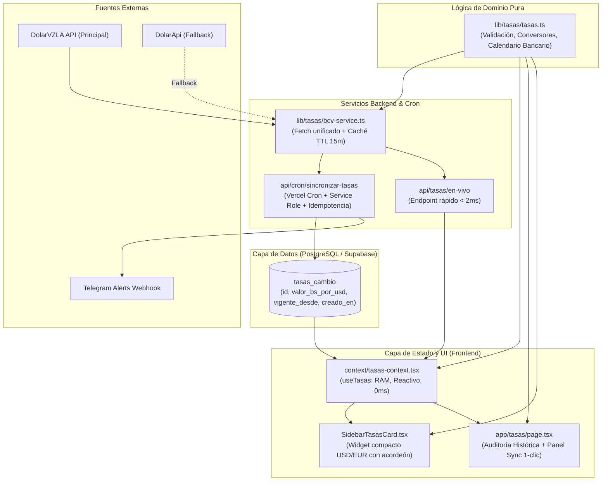

# Blueprint de Integración: Módulo Autónomo de Tasas BCV Multimoneda

Este documento constituye la **especificación arquitectónica canónica** del módulo de gestión de tasas del Banco Central de Venezuela (BCV), diseñado para operar de forma autónoma o integrarse en cualquier aplicación empresarial (ERPs, CRMs, comercio electrónico, facturación y gestión de pedidos) que requiera transacciones en Bolívares (VES) y Dólares (USD).

---

## 1. Prompt Maestro para Replicar con Herramientas de IA

Para replicar este módulo completo en cualquier otro proyecto, copia y pega la siguiente instrucción a Claude, ChatGPT, Gemini o Antigravity:

```text
Actúa como Arquitecto de Software Senior y Desarrollador Full-Stack. Necesito que instales e implementes en este proyecto el Módulo Autónomo de Tasas BCV Multimoneda siguiendo estrictamente el estándar de APSys documentado en el Blueprint.

El módulo debe incluir todas sus capas:
1. Base de datos: Tabla PostgreSQL `tasas_cambio` con histórico inmutable de vigencias, auditoría y políticas de lectura pública y escritura restringida.
2. Servicios de integración BCV: Cliente en TypeScript con consumo unificado de la API oficial DolarVZLA (USD + EUR) y fallback automático de alta disponibilidad a DolarApi, con caché en memoria (TTL 15 min).
3. Lógica de negocio y calendario bancario: Detección de doble vigencia (tasa vigente hoy vs. tasa programada siguiente), lógica de calendario para fines de semana (viernes rige hasta lunes) y feriados bancarios, y conversores matemáticos exactos (USD a Bs y Bs a USD) a 2 decimales para moneda y 4 para la tasa.
4. Automatización y Crons: Route Handler seguro con Vercel Cron (6:30 p.m. y 12:05 a.m.) protegido con Bearer Token y webhook de alertas fail-safe a Telegram.
5. Contexto y Estado React: Proveedor `TasasProvider` y hook `useTasas()` para hidratar cotizaciones en RAM (0ms) en formularios y conversores.
6. Interfaz de Usuario:
   - Widget de Sidebar/Navbar con tarjetas desplegables para USD y EUR (diseño premium, badges dinámicos según calendario y estado colapsable persistente).
   - Pantalla de Gestión `/tasas`: Panel de sincronización a 1 clic con la API en vivo, formulario gerencial de ajuste manual de contingencia, y tabla de auditoría histórica inmutable con badges contextuales ("Vigente", "Fin de semana", "Programada para el lunes", "Histórica").

Asegúrate de no usar textos hardcodeados de fechas ("Hoy" o "Mañana"), sino evaluar dinámicamente el desfase de días respecto a la zona horaria America/Caracas (UTC-4). Escribe pruebas unitarias completas antes de finalizar.
```

---

## 2. Arquitectura en Capas del Módulo



---

## 3. Capa 1: Base de Datos (PostgreSQL / Supabase)

### Script SQL de Migración (`0001_tasas_cambio.sql`)
```sql
-- Tabla inmutable de vigencias cambiarias
CREATE TABLE IF NOT EXISTS public.tasas_cambio (
    id UUID PRIMARY KEY DEFAULT gen_random_uuid(),
    valor_bs_por_usd NUMERIC(16, 4) NOT NULL CHECK (valor_bs_por_usd > 0),
    vigente_desde TIMESTAMPTZ NOT NULL,
    creado_en TIMESTAMPTZ NOT NULL DEFAULT timezone('utc'::text, now())
);

-- Índices de alto rendimiento
CREATE INDEX IF NOT EXISTS idx_tasas_cambio_vigente_desde 
ON public.tasas_cambio (vigente_desde DESC);

-- Seguridad a nivel de filas (RLS)
ALTER TABLE public.tasas_cambio ENABLE ROW LEVEL SECURITY;

-- Lectura permitida a usuarios autenticados
CREATE POLICY "Lectura de tasas para autenticados" 
ON public.tasas_cambio FOR SELECT 
TO authenticated 
USING (true);

-- Escritura restringida al rol de servicio o gerencial
CREATE POLICY "Escritura de tasas restringida" 
ON public.tasas_cambio FOR INSERT 
TO authenticated 
WITH CHECK (
    auth.jwt() ->> 'role' = 'service_role' OR 
    EXISTS (
        SELECT 1 FROM public.perfiles 
        WHERE usuario_id = auth.uid() AND rol = 'gerencial'
    )
);
```

---

## 4. Capa 2: Lógica de Dominio y Calendario Bancario (`lib/tasas/tasas.ts`)

### Reglas de Negocio Esenciales:
1. **Precisión Matemática:**
   - La tasa se almacena con **4 decimales** (ej. `880.1159`).
   - Las conversiones monetarias se redondean a **2 decimales exactos** (`Math.round(val * 100) / 100`) para evitar descuadres de centavos.
2. **Zona Horaria Oficial:**
   - Todo cálculo de fechas se ancla estrictamente a **`America/Caracas` (UTC-4)**.
   - Las vigencias inician a las **00:00:00 (medianoche)** de la fecha estipulada por el BCV.
3. **Dinámica de Calendario Bancario (Fin de Semana y Próximo Día Hábil):**
   - El BCV publica el viernes por la tarde la cotización que regirá el día hábil siguiente (lunes).
   - Durante **sábado y domingo**, la tasa de viernes continúa siendo la **tasa vigente activa**.
   - No debe mostrarse `"Hoy, 16/10"` en sábado o domingo; debe mostrarse `"Vigente (Fin de semana)"` o `"Vigente • 16/10"`.
   - La tasa futura de lunes no debe etiquetarse como `"Mañana, 19/10"` un viernes o sábado, sino `"Lunes, 19/10/2026 (Próx. Día Hábil)"`.

### Funciones Puras Clave:
```typescript
// 1. Conversores
export function calcularConversionBsUsd(montoUsd: number, tasa: number): number;
export function calcularConversionUsdBs(montoBs: number, tasa: number): number;

// 2. Doble Vigencia
export function obtenerTasaVigenteParaFecha(historial: TasaHistorica[], fechaRef?: Date): TasaHistorica | null;
export function obtenerTasaProgramadaParaFecha(historial: TasaHistorica[], fechaRef?: Date): TasaHistorica | null;

// 3. Calendario Dinámico y Etiquetas Inteligentes
export interface DetalleVigencia {
  tipo: 'vigente_hoy' | 'vigente_fin_de_semana' | 'vigente_historica' | 'programada_manana' | 'programada_proximo_dia_habil' | 'historica';
  etiquetaCorta: string; // "Hoy", "Fin de semana", "Mañana", "Lunes", "Histórica"
  etiquetaBadge: string; // "Vigente (Hoy)", "Vigente (Fin de semana)", "Programada (Lunes)"
  descripcionOperativa: string;
}
export function describirEstadoVigencia(fechaVigenciaIso: string, esVigenteActiva: boolean, fechaRef?: Date): DetalleVigencia;
```

---

## 5. Capa 3: Cliente de Integración BCV (`lib/tasas/bcv-service.ts`)

- **Fuente Primaria:** `https://rates.dolarvzla.com/bcv/current.json` (unifica USD, EUR y fechas de vigencia en una sola solicitud JSON ligera).
- **Fuente Secundaria (Failover):** `https://ve.dolarapi.com/v1/dolares/oficial` y `https://ve.dolarapi.com/v1/euros/oficial`.
- **Caché en Memoria:** TTL de 15 minutos en el servidor para evitar llamadas HTTP externas en cada navegación o render de componentes.

---

## 6. Capa 4: Automatización y Crons

### Vercel Cron (`vercel.json`)
```json
{
  "crons": [
    {
      "path": "/api/cron/sincronizar-tasas",
      "schedule": "30 22 * * 1-5"
    },
    {
      "path": "/api/cron/sincronizar-tasas",
      "schedule": "5 4 * * *"
    }
  ]
}
```
*Horarios Caracas:*
- **6:30 p.m. (22:30 UTC, lunes a viernes):** Detecta la publicación vespertina del BCV y programa la tasa del día siguiente.
- **12:05 a.m. (04:05 UTC, diario):** Asegura que la nueva jornada inicie con la tasa al día de forma automática.

### Fail-Safe Telegram Alerts
Si ambas APIs fallan o la base de datos no puede registrar la tasa, se dispara un webhook no bloqueante a Telegram:
```typescript
await enviarAlertaTelegram({
  titulo: "Fallo en Sincronización Automática BCV",
  mensaje: "No se pudo obtener la cotización oficial en el cron programado.",
  detalles: errorMsg,
});
```

---

## 7. Capa 5: Interfaz de Usuario y Auditoría

1. **Widget de Sidebar (`SidebarTasasCard.tsx`):**
   - Muestra tarjeta de tasa activa (verde esmeralda) y tarjeta de tasa futura (ámbar cálido).
   - Soporte para USD principal y EUR informativo.
   - Acordeones colapsables con persistencia en `localStorage` sincronizada en todas las pestañas.
2. **Página de Tasas (`/tasas`):**
   - **Columna Izquierda:** Panel de sincronización interactiva en vivo (1-clic) y notas operativas claras.
   - **Columna Derecha:** Tarjeta de **Histórico Inmutable** con tabla cronológica inversa, mostrando valores, marcas de tiempo y badges dinámicos adaptados a la realidad del calendario.
