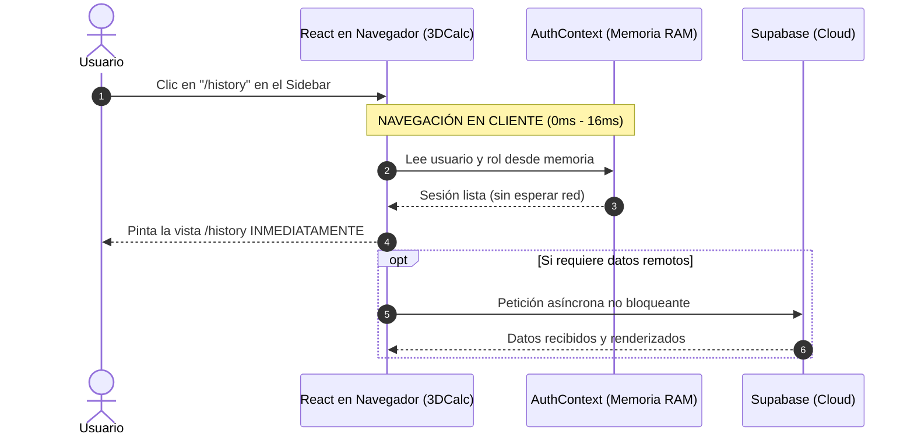
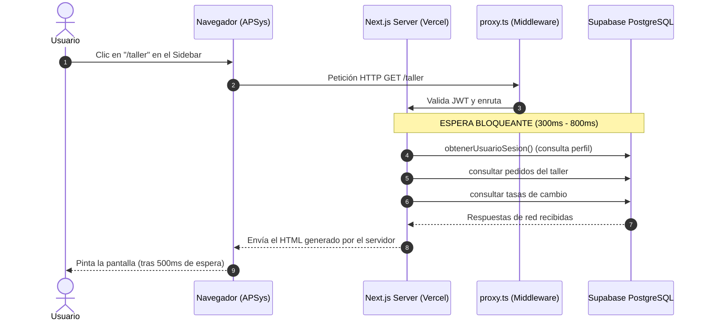

# Análisis Técnico y Comparativo de Arquitectura: 3DCalc vs. APSys

> **Fecha de Elaboración:** 13 de Octubre de 2026  
> **Estado:** Documento de Referencia Técnica y Auditoría de Arquitectura  
> **Objetivo:** Analizar la arquitectura del proyecto hermano **3DCalc** para extraer sus aciertos de rendimiento (latencia 0–16ms en navegación) e identificar sus debilidades y anti-patrones para no replicarlos en **APSys**.

---

## 1. Ficha Técnica y Contexto de Ambos Proyectos

| Dimensión              | 3DCalc (Calculadora 3D)                                                  | APSys (Taller de Producción Gráfica)                                                                                 |
| :--------------------- | :----------------------------------------------------------------------- | :------------------------------------------------------------------------------------------------------------------- |
| **Dominio de Negocio** | Cotizador de piezas 3D, inventario de bobinas y gestión de taller maker. | Sistema integral de órdenes de producción (taller), catálogo de servicios, clientes, cuentas por cobrar y tasas BCV. |
| **Framework Base**     | Next.js 14+ (App Router)                                                 | Next.js 15+ (App Router con PPR / React 19)                                                                          |
| **Base de Datos**      | Supabase (PostgreSQL + Auth + Storage)                                   | Supabase (PostgreSQL + Auth + RLS estricto + Realtime)                                                               |
| **Estilos & Diseño**   | Tailwind CSS (tema Dark/Light, Slate)                                    | Tailwind CSS v4 (paleta neutral Zinc, temas temáticos, badges dinámicos)                                             |
| **Testing**            | Pruebas básicas / manuales                                               | 171 tests en Vitest (100% verdes) + Playwright E2E                                                                   |
| **Sensación UX**       | **Ultra-fluida / Instantánea (0 a 16ms)**                                | Robusta y segura, pero con latencia perceptible de 300ms–800ms al navegar entre módulos.                             |

---

## 2. Diagrama de Flujo: ¿Por qué 3DCalc navega a 0ms mientras APSys espera al servidor?

### Flujo de Navegación en 3DCalc (Client-First SPA)



### Flujo de Navegación Actual en APSys (RSC Bloqueante)



---

## 3. Aciertos Técnicos de 3DCalc (Lo que SÍ debemos adoptar en APSys)

### 3.1. `RootLayout` como Cascarón Ligero de Cliente

En `3DCalc/src/app/layout.tsx`:

- El layout raíz no ejecuta ninguna función `async/await` ni consulta base de datos.
- Se limita a envolver los hijos en `<ThemeProvider>`, `<AuthProvider>` y `<AppShell>`.
- **Resultado:** El navegador recibe el layout base instantáneamente desde la memoria caché o el CDN de Vercel.

### 3.2. Instancia Singleton de Supabase en Cliente

En `3DCalc/src/lib/supabase/client.ts`:

```typescript
let clientInstance: SupabaseClient | null = null;

export function getSupabaseBrowserClient(): SupabaseClient | null {
  if (typeof window === "undefined") return null;
  if (clientInstance) return clientInstance;

  const url = process.env.NEXT_PUBLIC_SUPABASE_URL;
  const anonKey = process.env.NEXT_PUBLIC_SUPABASE_ANON_KEY;
  if (!url || !anonKey) return null;

  clientInstance = createBrowserClient(url, anonKey);
  return clientInstance;
}
```

- **Acierto:** Reutiliza la misma conexión en memoria en lugar de llamar `createBrowserClient` en cada render, ahorrando reconexiones de WebSockets, ciclos de CPU y consumo de memoria.

### 3.3. Sesión y Perfil en Memoria Reactiva (`AuthContext`)

- Utiliza `supabase.auth.onAuthStateChange()` para sincronizar eventos en vivo (login, logout, token refresh).
- Los componentes leen `const { user, profile } = useAuth()` de forma **síncrona**, eliminando llamadas al servidor durante el render de la interfaz.

---

## 4. Anti-Patrones y Fallas Críticas de 3DCalc (Lo que JAMÁS debemos replicar)

Durante la inspección de código fuente de `3DCalc`, se identificaron debilidades graves que comprometerían la integridad comercial de APSys:

### 4.1. Falla Crítica de Seguridad: Roles Quemados en Código (_Hardcoded_)

En `3DCalc/src/context/AuthContext.tsx`:

```typescript
// ⚠️ ANTI-PATRÓN GRAVE:
const ADMIN_EMAILS = [
  (process.env.NEXT_PUBLIC_ADMIN_EMAIL || "").toLowerCase().trim(),
  "medinachristian1984@gmail.com",
].filter(Boolean);

export const isSystemAdminEmail = (email?: string | null): boolean => {
  if (!email) return false;
  return ADMIN_EMAILS.includes(email.toLowerCase().trim());
};
```

- **Peligro:**
  1. Expone correos personales dentro del código JavaScript público que cualquier persona puede ver abriendo la consola del navegador.
  2. Si un usuario malintencionado edita la variable en memoria de React, el frontend le muestra las opciones de Super Admin.
  3. Ejecuta actualizaciones forzadas de rol hacia Supabase desde el cliente:
     `supabase.from("profiles").update({ role: "ADMIN" }).eq("id", userId).then();`
- **Cómo debe ser en APSys:**
  - En APSys, la seguridad reside **únicamente en PostgreSQL** mediante **RLS (Row Level Security)** y la tabla `perfiles`. Un usuario no puede auto-otorgarse el rol de administrador porque la base de datos rechaza la mutación en el servidor.

### 4.2. Tipado Laxo (`any`) y Supresión de Errores de BD

- En `3DCalc`:
  ```typescript
  // Si la consulta a la BD falla, inventa datos en memoria
  setProfile({
    id: userId,
    email: email,
    business_name: isMasterAdmin ? "Administración 3DPSys" : "Taller 3D",
    role: isMasterAdmin ? "ADMIN" : "MAKER",
    ...
  });
  ```
  Esto oculta caídas de red o errores de base de datos creando estados fantasmas difíciles de depurar.
- **Cómo debe ser en APSys:**
  - Estados claros: `isLoading`, `user`, `perfil` o `error`. Si la base de datos falla, se notifica claramente sin inventar datos que afecten dinero, órdenes de taller o tasas de cambio.

### 4.3. Degradación de Next.js a SPA Tradicional

- 3DCalc convirtió la aplicación en una SPA pura sin aprovechar las ventajas de los Server Actions protegidos para operaciones críticas como cobros o cambios de inventario.
- **En APSys:** Debemos mantener la interfaz ágil de una SPA en el frontend, pero respaldada por Server Actions verificados y transaccionales para mutaciones de negocio.

---

## 5. Matriz Comparativa Detallada

| Criterio de Evaluación                 |        3DCalc        |               APSys Actual                |       APSys con Transición Client-First (Propuesta)       |
| :------------------------------------- | :------------------: | :---------------------------------------: | :-------------------------------------------------------: |
| **Tiempo de cambio de ruta (Sidebar)** |    **0 – 16 ms**     |               400 – 900 ms                |                       **0 – 16 ms**                       |
| **Seguridad de Roles & Permisos**      | ⚠️ Débil (Hardcoded) |       🛡️ Blindada (PostgreSQL RLS)        |      🛡️ **Blindada (PostgreSQL RLS + AuthContext)**       |
| **Parpadeo de Sidebar al navegar**     |         Cero         |       Cero (optimizado en Fase 17)        |                         **Cero**                          |
| **Cálculo Multimoneda (USD/EUR)**      |   Manual / Básico    | Doble Vigencia Automática (Hoy vs Mañana) | **Doble Vigencia Automática en Memoria (`TasasContext`)** |
| **Resiliencia ante caídas de red**     | ⚠️ Estados fantasma  |      Fallback transparente con caché      |      **Caché en cliente (_Stale-While-Revalidate_)**      |
| **Cobertura de Pruebas Automatizadas** |        Mínima        |          171 tests (100% verde)           |           **171 tests + Suite E2E de latencia**           |

---

## 6. Hoja de Ruta para la Implementación en APSys

Para alcanzar la fluidez absoluta de 3DCalc manteniendo la calidad de ingeniería de APSys, se ejecutará el siguiente plan:

```
[Paso 1: Singleton Supabase] ──► lib/supabase/client.ts (Instancia única en navegador)
             ↓
[Paso 2: AuthContext Seguro] ──► context/auth-context.tsx (Sesión y rol real desde BD)
             ↓
[Paso 3: TasasContext SPA]   ──► context/tasas-context.tsx (Tasas en memoria sin latencia)
             ↓
[Paso 4: Shell Client]       ──► components/shell/authenticated-shell.tsx (Navegación en 0ms)
             ↓
[Paso 5: Vistas Desbloqueadas]──► /taller, /pedidos, /tasas (Carga fluida en cliente)
```

---

## 7. Conclusión y Recomendación

La velocidad de **3DCalc** no proviene de magia ni de una tecnología diferente, sino del **desacoplamiento del ciclo de renderizado de la interfaz respecto a las consultas de red del servidor**.

Adoptando ese desacoplamiento en **APSys** mediante `AuthContext` y `TasasContext`, obtendremos **la misma velocidad relámpago de 3DCalc**, pero sobre una base de código **profesional, fuertemente tipada, testeada y 100% segura**.
